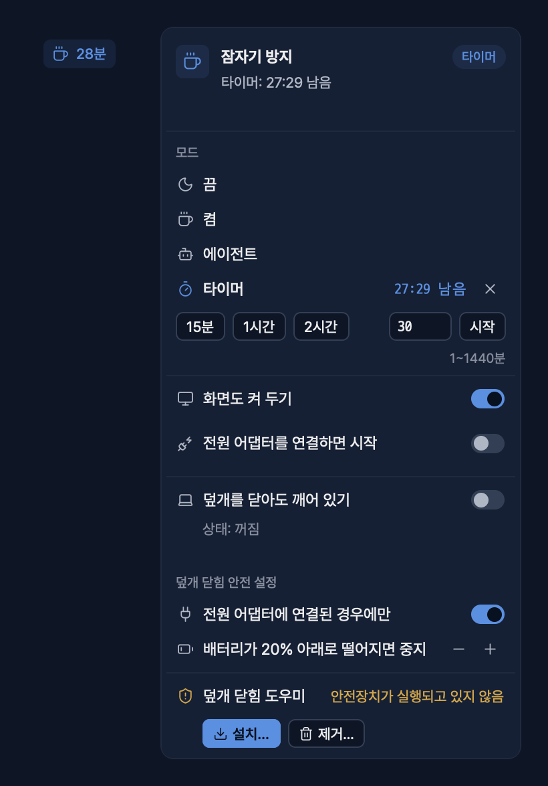

# herdr-caffeinate

[English](README.md)

필요할 때 Mac을 깨어 있게 하는 [Herdr 앱](https://herdr.dev) 모드입니다. 계속 깨어 있게 할 수도, Herdr 에이전트가 작업하는
동안이나 정한 시간 동안만 깨어 있게 할 수도 있고, 화면까지 켜 두거나 덮개를 닫은 채로 둘 수도 있습니다. Orca의 잠자기
방지, Amphetamine의 세션, Amphetamine과 Vorssaint의 덮개 닫힘 모드를 커피 칩 하나와 메뉴 하나로 Herdr 안에 옮겨 왔습니다.
덮개를 닫은 채 깨어 있는 동안에는 안전 기준을 계속 확인하고, Herdr가 죽으면 root 안전장치가 잠자기를 다시 켭니다. 그래서
Mac이 잠들 수 없는 상태로 남는 일은 없습니다.



*왼쪽이 칩, 오른쪽이 그 메뉴입니다. 30분 타이머로 화면까지 켜 둔 상태입니다. 덮개 닫힘 도우미를 아직 설치하지 않아
("안전장치가 실행되고 있지 않음") 메뉴에 설치 버튼이 보입니다.*

## 하는 일

**모드.** 메뉴나 단축키, 스크립트에서 하나를 고릅니다.

| 모드 | Mac을 깨어 있게 하는 때 |
|---|---|
| 끔 | 없음. Mac은 평소처럼 잠자기에 들어갑니다 |
| 켬 | 끌 때까지 |
| 에이전트 | 로컬 Herdr 터미널 중 하나라도 에이전트 상태가 `working`인 동안, 그리고 마지막 에이전트가 멈춘 뒤 30초(`agent.lingerSec`) 동안 |
| 타이머 | 15분, 1시간, 2시간, 또는 1~1440분 중 원하는 시간 동안. 칩과 메뉴에 남은 시간이 나오고, 끝나면 끔으로 돌아갑니다 |

모드가 Mac을 깨어 있게 하는 동안 이 모드는 Orca처럼 프로세스 하나를 띄웁니다:
`/usr/bin/caffeinate -i -s -w <Herdr pid>`. `-i`는 유휴 잠자기를, `-s`는 시스템 잠자기를 막고(macOS는 전원 어댑터에
연결된 동안에만 따릅니다), `-w`는 Herdr가 끝나면 이 프로세스도 끝냅니다. 충돌이나 `kill -9`로 끝나도 마찬가지입니다.
타이머 세션에는 `-t <남은 초>`가 붙어서, 모드가 지켜보지 못하는 동안에도 제때 끝납니다. 모드는 저장되어 Herdr를 다시
시작해도 이어지고, 타이머는 끝날 시각이 아직 남아 있을 때만 이어집니다.

**화면.** "화면도 켜 두기"를 켜면 그 프로세스에 `-d`가 붙어 화면도 어두워지거나 꺼지지 않습니다. 기본은 꺼짐입니다.

**덮개 닫힘.** "덮개를 닫아도 깨어 있기"는 Amphetamine의 Closed-Display Mode, Vorssaint와 같은 방식입니다. 모드가 Mac을
깨어 있게 하는 동안 `pmset -a disablesleep 1`을 설정해 덮개를 닫아도 잠들지 않게 하고, 모드가 그만두거나 스위치를 끄면
`disablesleep 0`으로 되돌립니다. 그냥 `caffeinate`로는 안 됩니다. 외장 디스플레이를 쓰지 않는 한, MacBook은 caffeinate가
무엇을 요청하든 덮개를 닫으면 잠듭니다. 덮개 닫힘은 관리자 암호로 한 번 설정해야 씁니다([덮개 닫힘 설정](#덮개-닫힘-설정)).
메뉴에는 상태가 나옵니다: 꺼짐, 켜짐, 일시 중지됨(이유와 함께), 사용할 수 없음(설정하지 않았거나 시스템 설정을 바꾸지
못함), 다른 앱이 설정함.

**안전장치.** 덮개 닫힘은 기본적으로 전원 어댑터에 연결된 동안에만 돌고, 배터리가 20% 아래로 떨어지거나 Mac이
뜨거워지면 일시 중지합니다. 덮개가 닫힌 채로 끝나면 Mac을 잠재우고, Herdr가 죽거나 멈추면, 그리고 배터리가 10% 아래로
떨어지면 root 안전장치가 1분쯤 안에 잠자기를 다시 켭니다. 자세한 내용은 [안전장치](#안전장치)에 있습니다.

**전원 어댑터 트리거.** "전원 어댑터를 연결하면 시작"을 켜 두면 어댑터를 꽂을 때 세션이 시작됩니다(켬, 또는
`trigger.ac.mode`로 에이전트). 어댑터를 빼면 어댑터가 시작한 세션만 끝납니다. 꽂혀 있는 동안 손으로 끄면 다음에 뺐다가
다시 꽂을 때까지 자동으로 시작하지 않습니다.

**칩, 메뉴, 명령.**

- 칩: Mac이 잠들 수 있을 때는 차분한 색, 깨어 있게 하는 동안은 강조색으로 바뀌는 커피잔입니다. 작은 점이 덮개 닫힘을
  나타냅니다. 켜져 있으면 강조색, 일시 중지됐거나 사용할 수 없거나 다른 앱이 설정했으면 주황색입니다. 폭이 72px 이상이면
  글자도 붙습니다. 타이머면 남은 분, 아니면 모드입니다. 툴팁에 모든 내용이 나옵니다.
- 메뉴(칩을 누르거나, 어디서든 ⌘⇧A): 네 가지 모드, 타이머 프리셋과 분 입력란, 취소 버튼이 붙은 남은 시간, 화면 스위치,
  전원 어댑터 스위치, 상태와 일시 중지 이유가 붙은 덮개 닫힘 스위치, 덮개 닫힘 안전 설정(전원 어댑터에 연결된 경우에만,
  5% 단위 배터리 하한), 덮개 닫힘 도우미의 상태와 설치…·제거… 버튼.
- 모든 동작은 단축키, 다른 모드, 스크립트에서 쓸 수 있는 명령입니다: `herdr-app do herdr-caffeinate.mode:on`
  ([명령](#명령)).
- [lazuli](https://github.com/Lapis0875/herdr-lazuli) 레이아웃에서는 이 모드를 설치하기만 하면 상태 표시줄에 칩이 저절로
  나오고, lazuli 팔레트에 명령이 나옵니다.

**한국어와 영어.** macOS 언어를 따르고(한국어면 한국어, 그 밖에는 영어), `language` 설정으로 바꿀 수 있습니다.

## 필요한 것

| | |
|---|---|
| macOS | macOS 27, Apple 실리콘(MacBook)에서 만들고 써 왔습니다 |
| [Herdr 앱](https://herdr.dev) | 0.1.16. 설치 단계에서는 `PATH`에 `herdr-app`이 있어야 합니다 |
| 관리자 계정 | 덮개 닫힘에만 필요합니다. 한 번 하는 설정이 `sudo`를 실행합니다 |
| `jq` | 선택. 설치 3단계에서 단축키를 합칠 때 씁니다 |
| [Node.js](https://nodejs.org) | 테스트(`npm test`)에만 필요합니다. 26.13으로 만들었습니다 |

모드 자체는 다른 것이 필요 없습니다. 실행하는 프로그램은 모두 macOS에 들어 있습니다
([실행하고 읽고 쓰는 것](#실행하고-읽고-쓰는-것)).

## 설치

아래 경로는 Herdr 앱 홈이 `~/.config/herdr-app`이라고 가정합니다(아니면 `HERDR_APP_HOME`). 이름은 바꿀 수 없습니다. 모드는
반드시 `mods/herdr-caffeinate`에 있어야 합니다.

1. 이 저장소의 사본에서, 덮어쓸 것이 없는지 확인합니다.

   ```sh
   APP=~/.config/herdr-app
   [ -e "$APP/mods/herdr-caffeinate" ] && echo "already there: $APP/mods/herdr-caffeinate"
   ```

   무언가 출력되면 멈추세요. 이미 다른 사본이 설치되어 있습니다.

2. 모드를 복사합니다. **`mod.json`을 먼저** 복사해야 합니다.

   ```sh
   mkdir "$APP/mods/herdr-caffeinate"
   cp mods/herdr-caffeinate/mod.json "$APP/mods/herdr-caffeinate/"
   cp -R mods/herdr-caffeinate/ "$APP/mods/herdr-caffeinate/"
   ```

   Herdr는 모드 폴더를 처음 보면, `mod.json`에 `"place": "none"`이 없는 한 화면에 보이는 레이아웃에 그 모드를 하나
   붙입니다. `mod.json`보다 `main.js`가 먼저 들어오면 Herdr가 herdr-caffeinate를 320px 블록으로 그 레이아웃에 붙이고
   레이아웃 파일을 고쳐 씁니다. 그렇게 됐다면 `$APP/layouts/`의 해당 파일에서
   `{ "mod": "herdr-caffeinate", "size": { "px": 320 } }` 블록을 지우세요.

3. 단축키를 더합니다. 이 저장소의 `keys.json`을 내 것에 합칩니다. 항목은 하나, `global` 섹션의 ⌘⇧A(`cmd-shift-a`) →
   `mod.open:herdr-caffeinate`이고, 어느 레이아웃에서든 메뉴를 엽니다. 그 키가 비어 있는지 확인하고(`null`이 출력되면
   비어 있습니다), 백업을 남긴 채 합칩니다.

   ```sh
   jq '.global["cmd-shift-a"]' "$APP/keys.json"
   cp "$APP/keys.json" "$APP/keys.json.before-caffeinate"
   jq -s '.[0] * .[1]' "$APP/keys.json.before-caffeinate" keys.json > "$APP/keys.json"
   ```

   `*`는 안쪽까지 합치므로 `global`의 다른 키는 그대로 남습니다. 한 번 고친 `keys.json`은 그 뒤로 Herdr가 내 파일로
   여깁니다.

4. 칩을 보이게 합니다. 둘 중 하나입니다.

   - **lazuli:** 할 일이 없습니다. lazuli가 다음에 시작할 때(Herdr 시작, lazuli로 전환, lazuli 다시 불러오기)
     `mods/herdr-caffeinate/mod.json`을 찾아 상태 표시줄에 칩을 그리고 팔레트에 명령을 넣습니다.
   - **다른 레이아웃:** 레이아웃 파일의 가로줄(위쪽 바나 상태 표시줄 등)에 40px 블록을 더합니다.

     ```json
     { "id": "caffeinate", "type": "block", "size": { "px": 40 }, "content": { "mod": "herdr-caffeinate" } }
     ```

     어디에 넣으면 좋은지, 폭이 넓으면 무엇이 보이는지는 [RECIPE.md](RECIPE.md)(영어)에 있습니다.

   칩이나 lazuli가 모드의 엔진을 돌립니다. 둘 다 없는 레이아웃에서는 ⌘⇧A로 메뉴를 열면 다음 레이아웃 전환 때까지 엔진이
   돕니다(그 사이에 일어나는 일은 [안전장치](#안전장치)에 있습니다).

5. 모드를 점검합니다.

   ```sh
   herdr-app check ~/.config/herdr-app/mods/herdr-caffeinate
   ```

6. 칩이 보이는 상태에서 써 봅니다.

   ```sh
   herdr-app do herdr-caffeinate.mode:on
   pgrep -lf "^/usr/bin/caffeinate -i -s.* -w $(pgrep -x Herdr)( |$)"
   pmset -g assertions | grep -A2 caffeinate
   herdr-app do herdr-caffeinate.mode:off
   ```

   `pgrep`에 프로세스 하나가 나오고, `pmset -g assertions`에 그 프로세스의 `PreventUserIdleSystemSleep`과
   `PreventSystemSleep`이 나옵니다. 다른 앱도 자기 `caffeinate`를 띄울 수 있습니다(Orca는 `-w <Orca pid>`로 띄웁니다).
   이 모드의 것은 `-w <Herdr pid>`가 붙은 것뿐입니다.

## 덮개 닫힘 설정

덮개 닫힘은 시스템 설정 `pmset -a disablesleep`을 바꾸는데, 이것은 root 권한이 필요합니다. 모드는 암호를 묻지 않습니다.
sudoers 규칙 하나가 허용하는 정확히 두 명령만 `sudo -n`(대화 없이)으로 실행합니다. 한 번 실행하는 설치 프로그램이 그
규칙과 root 안전장치를 설치합니다.

### 도우미 설치

메뉴에서 **설치…**를 누릅니다(또는 `herdr-app do herdr-caffeinate.install`). Herdr가 `herdr-caffeinate install`이라는 탭을
열고 그 안에서 `bin/install.sh`를 내 계정으로 실행합니다. `sudo`가 관리자 암호를 **한 번** 묻습니다. 직접 실행해도 됩니다:
`/bin/sh ~/.config/herdr-app/mods/herdr-caffeinate/bin/install.sh`. root로는 실행을 거부합니다.

순서대로 하는 일:

1. 첫 `sudo`를 부르기 전에 **확인합니다.** 사용자 이름이 `^[a-z_][a-z0-9_-]*$`에 맞는지(sudoers 규칙에 쓸 수 있는 문자는
   이것뿐입니다), 홈이 `/Users/<이름>`이고 내가 가진 실제 폴더인지 봅니다.
2. **sudoers 규칙.** `bin/sudoers.tmpl`에 내 사용자 이름을 넣어 임시 파일로 만들고 `visudo -cf`로 검사한 뒤,
   `/etc/sudoers.d/herdr-caffeinate`(root:wheel 0440)로 설치합니다. 점이 들어간 이름으로 먼저 썼다가 이름을 바꾸므로
   (sudo는 그런 이름을 건너뜁니다) 반쯤 쓴 파일을 sudo가 읽는 일은 없습니다. 이어서 설치한 것만 확인합니다.
   `sudo visudo -cf /etc/sudoers.d/herdr-caffeinate`로 우리 파일 하나를 검사하고, `sudo -n -l /usr/bin/pmset -a disablesleep 0`과
   `… 1`로 sudo가 두 명령을 암호 없이 허용하는지 봅니다. 하나라도 실패하면 파일을 다시 지웁니다. 마지막으로 sudoers 파일
   전체를 보는 `sudo visudo -c`를 실행하지만, 다른 앱의 파일에 대해 알려 주는 내용을 `note:` 줄로 보여 줄 뿐 설치를 멈추지
   않습니다. 예를 들어 Amphetamine의 Power Protect는 `/private/etc/sudoers.d/amphetamine_PowerProtect`를 0644 권한으로
   설치하므로 `visudo -c`가 `bad permissions, should be mode 0440`을 알리며 실패하지만, sudo는 그 파일을 그대로 읽습니다.
   우리 파일에는 딱 한 줄이 들어갑니다.

   ```
   <you> ALL = (root) NOPASSWD: /usr/bin/pmset -a disablesleep 0, /usr/bin/pmset -a disablesleep 1
   ```

   sudo는 인자를 정확히 비교하므로, 이 규칙은 이 두 명령만 허용합니다. 다른 `pmset` 인자도, 다른 사용자도 안 됩니다.
3. **안전장치 도우미.** `bin/failsafe.sh`를
   `/Library/PrivilegedHelperTools/io.github.lapis0875.herdr-caffeinate.failsafe`(root:wheel 0755)로 복사하고
   `/var/db/herdr-caffeinate/`(root:wheel 0755)를 만듭니다. 데몬은 root가 가진 이 사본을 실행하고, 내 모드 폴더의 파일은
   실행하지 않습니다.
4. **LaunchDaemon.** `bin/failsafe.plist.tmpl`에 내 홈을 넣고 `plutil -lint`로 검사한 뒤
   `/Library/LaunchDaemons/io.github.lapis0875.herdr-caffeinate.failsafe.plist`(root:wheel 0644)로 설치합니다. 그다음
   `launchctl bootout`(예전 사본, 오류는 무시), `launchctl enable`, `launchctl bootstrap system`을 실행합니다. 데몬은 처음
   불러올 때와 그 뒤 15초마다 `/bin/sh <도우미> /Users/<you>/.herdr/herdr-caffeinate/claim`을 실행합니다.
5. 안전장치가 `/var/db/herdr-caffeinate/alive`를 건드릴 때까지 최대 30초 **기다립니다.**

탭은 `[exit N] Press Enter to close.`로 끝납니다.

| 종료 코드 | 뜻 |
|---|---|
| 0 | 설치됨 |
| 1 | 거부: root로 실행했거나, 쓸 수 없는 사용자 이름이나 홈이거나, 파일이 없음 |
| 2 | 인자가 잘못됨 |
| 10 | sudoers 단계 실패: 암호가 거부됐거나, 우리 파일이 `visudo -cf`를 통과하지 못했거나, `sudo -n -l`이 두 명령 중 하나를 거부함. 우리 파일은 지웠습니다 |
| 20 | 도우미나 `/var/db/herdr-caffeinate`를 설치하지 못함 |
| 30 | plist나 데몬 단계 실패, 또는 안전장치가 30초 안에 살아 있다고 알리지 않음 |

20이나 30이 나오면 제거 프로그램으로 설치된 것을 치우세요. 설치 프로그램은 다시 실행해도 됩니다. 모든 파일을 새로
바꿉니다.

**"백그라운드 항목이 추가됨"(Background Items Added).** 데몬을 불러오면 macOS가 이 알림을 띄우고, 시스템 설정 → 일반 →
로그인 항목 및 확장 프로그램의 "백그라운드에서 허용"에 데몬이 나옵니다. 허용한 채로 두세요. 끄면 안전장치가 멈추고, 다시
돌 때까지 덮개 닫힘은 사용할 수 없음으로 나옵니다.

그러면 메뉴에 도우미가 설치됨으로 나옵니다. 메뉴는 두 가지를 확인합니다(공유 상태의 `install`). `sudo`는
`sudo -n -l /usr/bin/pmset -a disablesleep 0`과 `… 1`이 둘 다 성공하는지, `failsafe`는 `alive`가 60초 안에 갱신됐는지입니다.
덮개 닫힘은 둘 다 필요합니다.

### Herdr 앱 홈 밖의 파일

| 경로 | 소유자, 권한 | 무엇인가 |
|---|---|---|
| `~/.herdr/herdr-caffeinate/` | 나, 0700 | 모드의 실행 폴더 |
| `~/.herdr/herdr-caffeinate/claim` | 나, 0600 | 내 Herdr가 `disablesleep 1`을 쥐고 있는 동안 있는 파일. 수정 시각이 안전장치가 보는 심장 박동입니다(10초마다 갱신). 내용 `{v:1, owner:{pid, appHome}, since}`는 모드만 읽습니다 |
| `~/.herdr/herdr-caffeinate/engine` | 나, 0600 | 이 버전은 쓰지 않는 keeper 대안용 자리입니다([docs/spikes/S3.md](docs/spikes/S3.md)). 만들지 않습니다 |
| `/etc/sudoers.d/herdr-caffeinate` | root:wheel 0440 | 위의 sudoers 규칙 |
| `/Library/PrivilegedHelperTools/io.github.lapis0875.herdr-caffeinate.failsafe` | root:wheel 0755 | `bin/failsafe.sh`의 root 사본 |
| `/Library/LaunchDaemons/io.github.lapis0875.herdr-caffeinate.failsafe.plist` | root:wheel 0644 | LaunchDaemon `io.github.lapis0875.herdr-caffeinate.failsafe` |
| `/var/db/herdr-caffeinate/{alive,armed,handled,last-restore}` | root, 폴더 0755, 파일 0644 | 안전장치의 상태, 누구나 읽을 수 있습니다. `alive`는 실행할 때마다 갱신, `armed`는 새로 갱신된 claim 아래에서 `disablesleep 1`을 본 동안 있음, `handled`는 이미 되돌린 오래된 claim, `last-restore`는 `<epoch> <이유>` |

### 도우미 제거

메뉴에서 **제거…**를 누릅니다(또는 `herdr-app do herdr-caffeinate.uninstall`, 또는
`/bin/sh ~/.config/herdr-app/mods/herdr-caffeinate/bin/uninstall.sh`). 내 계정으로 돌고, 단계마다 `sudo`를 씁니다.

1. `~/.herdr/herdr-caffeinate/claim`이나 `/var/db/herdr-caffeinate/armed`가 있고(덮개 닫힘이 켜져 있을 수 있음)
   `SleepDisabled`가 0이 아니면 `sudo pmset -a disablesleep 0`을 실행합니다.
2. `sudo launchctl bootout system/io.github.lapis0875.herdr-caffeinate.failsafe`.
3. plist, 도우미, `/var/db/herdr-caffeinate/`, `/etc/sudoers.d/herdr-caffeinate`를 지웁니다.
4. 데몬이 사라졌는지(`launchctl print`), `/etc/sudoers.d/herdr-caffeinate`를 포함해 남은 경로가 없는지 확인합니다.
   이어서 sudoers 파일 전체를 보는 `sudo visudo -c`를 실행하지만, 다른 앱의 sudoers 파일에 대한 내용(위의 Amphetamine
   0644 파일 등)을 `note:` 줄로 보여 줄 뿐 종료 코드는 바꾸지 않습니다.
5. `SleepDisabled`가 여전히 1이면 다른 도구가 설정한 것입니다. 그렇다고 알려 주고 건드리지 않습니다
   (`sudo pmset -a disablesleep 0`으로 풀 수 있습니다).

| 종료 코드 | 뜻 |
|---|---|
| 0 | 모두 지움 |
| 1 | 거부: root로 실행했거나, 쓸 수 없는 사용자 이름이나 홈 |
| 40 | 무언가 남았거나, `disablesleep 0` 되돌리기가 실패함. 위의 메시지에 무엇인지 나옵니다 |

"백그라운드에서 허용"의 macOS 항목은 데몬과 함께 사라집니다. `~/.herdr/herdr-caffeinate/`는 남습니다(덮개 닫힘이 꺼져
있으면 비어 있습니다). `rm -r ~/.herdr/herdr-caffeinate`로 지우세요.

## 명령

단축키, 다른 모드의 `run()`, 또는 `herdr-app do herdr-caffeinate.<명령>`으로 씁니다. `herdr-app do`는 `{"ok": true}`를
출력합니다. 모드의 사본이 화면에 있을 때만(칩, lazuli의 숨은 호스트, 열린 메뉴) 닿고, 아니면 "need the mod loaded"와 함께
1로 끝납니다. 모르는 명령이나 형식이 틀린 명령은 아무것도 바꾸지 않고 로그 한 줄만 남깁니다.

| 명령 | 하는 일 |
|---|---|
| `toggle` | 끔 ↔ 켬과 에이전트 중 마지막에 쓴 것(처음에는 켬) |
| `mode:off`, `mode:on`, `mode:agent` | 그 모드 |
| `timer:<분>` | 1~1440분 타이머(`timer:0`, `timer:1441`, `timer:abc`는 아무것도 하지 않음) |
| `timer:cancel` | 타이머를 바로 끝냄 |
| `display:on`, `display:off`, `display:toggle` | 화면도 켜 두기 |
| `closed-lid:on`, `closed-lid:off`, `closed-lid:toggle` | 덮개를 닫아도 깨어 있기 |
| `menu` | 메뉴를 열고 전원 상태를 바로 읽음 |
| `refresh` | `settings.json`과 전원 상태를 다시 읽어 바로 적용 |
| `install`, `uninstall` | `bin/install.sh`나 `bin/uninstall.sh`를 실행하는 Herdr 탭을 엶 |

| 키 | 동작 | 하는 일 |
|---|---|---|
| ⌘⇧A `cmd-shift-a` (`global`) | `mod.open:herdr-caffeinate` | 어느 레이아웃에서든 메뉴를 엶 |

`display:*`와 `closed-lid:*`는 언제든 설정을 바꾸고, 모드가 Mac을 깨어 있게 하는 동안 적용됩니다.

## 설정

메뉴는 Herdr 앱 홈의 `data/herdr-caffeinate/settings.json`에 씁니다. 손으로 고쳐도 됩니다. 모드는 확인할 때마다(켜져
있는 동안 10~30초마다), 메뉴를 열 때, `herdr-app do herdr-caffeinate.refresh` 직후에 이 파일을 다시 읽습니다. 빠졌거나
잘못된 필드는 기본값을 쓰고, 모르는 필드는 그대로 둡니다.

| 필드 | 기본값 | 뜻 |
|---|---|---|
| `language` | `"system"` | `"system"`, `"ko"`, `"en"`. `system`은 macOS 선호 언어의 첫 번째를 따릅니다 |
| `mode` | `"off"` | `"off"`, `"on"`, `"agent"`, `"timer"`. 다시 시작해도 이어집니다 |
| `display` | `false` | 화면도 켜 두기(`caffeinate -d`) |
| `timer.presetsMin` | `[15, 60, 120]` | 프리셋 버튼. 1~1440분 값 1~8개 |
| `timer.lastCustomMin` | `45` | 분 입력란의 값 |
| `agent.lingerSec` | `30` | 마지막 에이전트가 작업을 멈춘 뒤 에이전트 모드가 더 깨어 있는 초(0~3600) |
| `agent.includeRemote` | `false` | 다른 머신의 에이전트도 셈 |
| `closedLid.enabled` | `false` | 덮개를 닫아도 깨어 있기 |
| `closedLid.acOnly` | `true` | 덮개 닫힘은 전원 어댑터에 연결된 경우에만 |
| `closedLid.batteryFloor` | `20` | 배터리가 이 %보다 낮으면 덮개 닫힘을 일시 중지. 10~90으로 맞춥니다 |
| `trigger.ac.enabled` | `false` | 전원 어댑터를 연결하면 세션 시작 |
| `trigger.ac.mode` | `"on"` | 그 세션의 모드: `"on"` 또는 `"agent"` |
| `debug` | `false` | 10초마다 확인하고 `fake`를 허용 |
| `fake` | 없음 | `debug: true`일 때만. `{ "ac", "percent", "thermal", "lidClosed" }`가 Mac에서 읽은 값을 대신합니다. 안전 규칙을 시험할 때 씁니다 |

같은 폴더에 모드가 쓰는 파일이 둘 더 있습니다. `runtime.json`(돌고 있는 세션과 끝날 시각, 프로세스의 pid와 명령, 전원
어댑터 트리거의 상태)과 `state.json`(아래 공유 상태의 사본, 스크립트용:
`jq . ~/.config/herdr-app/data/herdr-caffeinate/state.json`)입니다.

다른 모드는 공유 키 `herdr-caffeinate.state`를 읽습니다.

```json
{ "v": 1, "at": 1763568000000, "mode": "off|on|agent|timer", "active": true,
  "reason": "user|agent|timer|trigger|null", "display": false, "endsAt": null,
  "closedLid": { "wanted": false, "status": "off|engaged|blocked|unavailable|external",
    "blocked": "ac|battery|thermal|unknown|other-instance|null" },
  "install": { "sudo": true, "failsafe": true } }
```

## 안전장치

**일반 잠자기 방지**(`caffeinate`)는 권한이 필요 없고 Herdr보다 오래 살 수 없습니다. Herdr가 끝나거나 충돌하거나 죽으면
`-w <Herdr pid>` 때문에 몇 초 안에 끝납니다. 모드는 `ps`에 자기가 띄운 명령이 정확히 보일 때만 그 프로세스를 끝내고, 시작할
때 같은 Herdr의 남은 프로세스(다시 불러오면서 놓친 것)를 정리하므로 언제나 하나만 돕니다.

**덮개 닫힘**은 모드가 Mac을 깨어 있게 하는 동안에만 돌고, 다음 경우에는 일시 중지합니다(상태 "일시 중지됨", 이유 표시).

| 기준 | 기본값 | 풀리는 때 |
|---|---|---|
| `closedLid.acOnly`가 켜져 있는데 배터리로 작동 중 | 켜짐 | 전원 어댑터를 연결하면 |
| 배터리가 `closedLid.batteryFloor`보다 낮음 | 20% | 하한 + 5%가 되거나 전원 어댑터를 연결하면 |
| macOS 열 상태가 serious(2)나 critical(3) | 항상 | 연달아 두 번 fair(1) 이하로 읽히면 |
| 전원 상태를 연달아 세 번 읽지 못함 | 항상 | 다음에 제대로 읽히면 |
| 이 Mac의 다른 Herdr가 덮개 닫힘을 쥐고 있음 | 항상 | 그쪽이 놓으면 |

덮개 닫힘이 켜져 있는 동안 모드는 10초마다 확인합니다. 열 상태는 덮개 닫힘 스위치가 켜져 있을 때만 읽습니다.

- **덮개 닫힘이 켜져 있지 않으면 닫힌 덮개는 Mac을 잠재웁니다(D7).** 덮개가 닫혀 있고 macOS가 덮개를 닫으면 잠드는
  상태(`AppleClamshellCausesSleep`이 Yes)인데 덮개 닫힘이 켜져 있지 않으면(꺼짐, 일시 중지, 사용할 수 없음, 다른 앱이
  설정함) 어떤 모드도 Mac을 깨어 있게 하지 않습니다. caffeinate 프로세스를 끝내는데, 그 프로세스의 `PreventSystemSleep`이
  남아 있으면 전원 어댑터에 연결된 동안 잠자기가 다크 웨이크로 바뀌기 때문입니다. 덮개가 닫힌 채로 어떤 이유로든 덮개
  닫힘이 끝나면 프로세스를 끝내고 완전히 끝날 때까지 기다린 뒤, `disablesleep`을 0으로 되돌리고 `pmset sleepnow`를
  실행합니다. 덮개가 닫힌 채로 세션이 기다리는 동안에는 10초마다 확인하고, Mac이 잠든 사이 건너뛴 확인은 깨어나자마자
  실행합니다. 덮개를 다시 열거나 `AppleClamshellCausesSleep`이 No로 읽히면(외장 디스플레이를 쓰는 클램셸 모드) 다시 모드에
  따라 깨어 있게 하며, 덮개를 연 뒤 10초 안에 다시 시작합니다. 그동안 모드와 타이머는 계속 이어지고, 칩과 공유 상태는
  Mac을 깨어 있게 하지 않는 것으로 표시합니다.
- **다시 읽기.** `disablesleep`을 바꿀 때마다 `pmset -g`로 다시 읽어 확인합니다. `disablesleep 1`이 들어가지 않으면 0으로
  되돌리고 claim을 지운 뒤 사용할 수 없음으로 표시합니다.
- **root 안전장치.** 덮개 닫힘이 켜져 있는 동안 모드는 claim 파일을 10초마다 갱신합니다. launchd가 15초마다 root로 실행하는
  안전장치는 새로 갱신된 claim 아래에서 `SleepDisabled 1`을 보면 대기 상태(armed)가 되고, 다음 경우에(`SleepDisabled`가
  1이면) `pmset -a disablesleep 0`을 실행합니다.
  - claim이 45초보다 오래됨(Herdr가 죽었거나 멈췄거나 `kill -STOP`으로 세워짐): 마지막 심장 박동 뒤 60초쯤 안에 잠자기가
    돌아옵니다. 깨어난 직후 60초 동안은 기다려서, 막 깨어난 Mac이 Herdr가 따라잡기 전에 끊기지 않게 합니다.
  - 대기 상태에서 claim이 사라짐.
  - 대기 상태에서 Mac이 배터리로 작동 중이고 **10%** 아래임. Herdr가 멈춰 있어도 그렇습니다.

  덮개가 닫혀 있고 macOS가 덮개를 닫으면 잠드는 상태라면 `pmset sleepnow`도 실행합니다. 시각과 이유(`stale-claim`,
  `claim-gone`, `battery-floor`)를 `/var/db/herdr-caffeinate/last-restore`에 씁니다.
- **다른 도구의 설정은 건드리지 않습니다.** claim도 없고 대기 상태도 아니면 안전장치는 `SleepDisabled`를 절대 바꾸지
  않습니다. 다른 도구가 이미 1로 해 두었으면 모드도 설정하지 않고 "다른 앱이 설정함"으로 표시합니다.
- **Herdr 밖에서 잠자기를 다시 켠 경우.** 덮개 닫힘이 켜져 있는데 안전장치가 아닌 다른 곳에서 `SleepDisabled`가 0으로
  돌아오면(예: 터미널에서 `sudo pmset -a disablesleep 0`) 모드는 덮개 닫힘 설정을 끄고 알려 줍니다. 안전장치가 되돌렸고
  조건이 여전히 맞으면 덮개 닫힘을 한 번 다시 켜고 알려 줍니다. 두 번째는 사용자가 끈 것으로 봅니다.
- **Herdr 종료**는 충돌과 같게 다룹니다. 끝날 때 아무것도 풀지 않습니다. 프로세스는 `-w`로 끝나고, 안전장치가 1분쯤 안에
  잠자기를 되돌립니다.
- **칩이 없는 레이아웃**(lazuli도 아닌)에서는 엔진이 돌지 않습니다. 그동안 덮개 닫힘은 안전장치가 1분쯤 안에 되돌리고,
  타이머의 프로세스는 제때 끝나며(`-t`), 켬이나 에이전트의 프로세스는 엔진이 다시 돌 때까지(칩을 보이게 하거나, lazuli로
  바꾸거나, ⌘⇧A) 또는 Herdr가 끝날 때까지 남습니다. 그동안 에이전트 모드는 에이전트를 따라가지 않습니다.

## 실행하고 읽고 쓰는 것

아래 목록은 소스에서 뽑았습니다. `mods/herdr-caffeinate/sys/`의 모든 `exec`, `mods/herdr-caffeinate/bin/`의 스크립트,
그 안에서 부르는 프로그램입니다. 모든 프로그램은 절대 경로로 부르고, 인자는 셸 문자열에 끼워 넣지 않고 인자로 넘깁니다.

**모드가 실행하는 프로그램**(내 계정으로, Herdr의 `exec`를 통해):

- `/usr/bin/caffeinate -i -s [-d] -w <Herdr pid> [-t <초>]`: 잠자기를 막는 프로세스입니다.
  `/bin/sh -c 'nohup "$@" >/dev/null 2>&1 & echo "$!"'`로 분리해 띄우므로 호출이 끝나도, 모드를 다시 불러와도 남습니다.
- `/bin/sh -c 'echo "$PPID"; /bin/ps -o command= -p "$PPID"'`: Herdr의 pid와 명령줄(`-w` 대상, 그리고 다른 Herdr의 claim과
  구별하기 위해).
- `/bin/ps -o command= -p <pid>`(그 pid가 아직 우리 프로세스인지, 살아 있는 Herdr인지), `/bin/ps -axo pid=,command=`(엔진이
  시작할 때 남은 프로세스 찾기), `/bin/kill <pid>`(명령줄이 맞을 때만 그 프로세스를 끝냄).
- `/usr/bin/sudo -n /usr/bin/pmset -a disablesleep 1`과 `… 0`: 권한이 필요한 명령은 이 둘뿐입니다. `sudo -n`은 묻지
  않으며, 거부되면 규칙이 설치되지 않은 것입니다. `/usr/bin/sudo -n -l /usr/bin/pmset -a disablesleep 0`과 `… 1`(규칙이
  허용하는지 나열만 하고 실행은 하지 않음)은 시작할 때, 명령을 받을 때, 메뉴를 열 때, 덮개 닫힘 스위치가 켜져 있는 동안
  5분마다 실행합니다.
- `/usr/bin/pmset sleepnow`(sudo 없이): 덮개가 닫힌 채로 덮개 닫힘이 끝날 때, caffeinate 프로세스가 끝난 뒤. 그때까지
  `/bin/sh -c`로 `/bin/kill -0 <pid>`와 `/bin/sleep 0.05`를 돌려 최대 1초 기다립니다.
- `/bin/sh -c '/usr/bin/pmset -g | /usr/bin/grep SleepDisabled'`: 바꾼 뒤 다시 읽기.
- `/bin/sh`로 실행하는 `bin/probe.sh [--thermal]`(읽기만 함, 확인할 때마다): `/usr/bin/pmset -g batt`(전원과 배터리 %),
  `/usr/bin/pmset -g | /usr/bin/grep SleepDisabled`,
  `/usr/sbin/ioreg -r -k AppleClamshellState -d 1 | /usr/bin/grep -E '"AppleClamshell(State|CausesSleep)"'`(덮개가
  닫혔는지, 닫으면 잠드는지), 덮개 닫힘 스위치가 켜져 있을 때만 `--thermal`로
  `/usr/bin/osascript -l JavaScript -e 'ObjC.import("Foundation"); $.NSProcessInfo.processInfo.thermalState'`, 그리고
  `/usr/bin/stat -f %m`(`alive`, claim, `last-restore`의 시각)과 `/bin/date +%s`.
- claim은 앱 홈 밖이라 `exec`로만 쓸 수 있습니다: `/bin/sh -c 'umask 077; /bin/mkdir -p … && /bin/chmod 700 … &&
  printf … > claim.tmp && /bin/mv -f claim.tmp claim'`(이름 바꾸기로 쓰므로 심볼릭 링크를 따라가지 않고 바꿔 놓습니다),
  `/usr/bin/touch -c <claim>`(심장 박동, 파일을 새로 만들지는 않음), `/bin/rm -f <claim>`.
- `/usr/bin/defaults read -g AppleLanguages`: 시스템 언어, 엔진이 시작할 때 한 번.
- 설치…와 제거…는 `/bin/sh -c '/bin/sh "$1"; …; read _' sh <앱 홈>/mods/herdr-caffeinate/bin/install.sh`(또는
  `uninstall.sh`)를 실행하는 Herdr 탭(`tab.new`)을 엽니다.

**설치·제거 프로그램**(그 탭에서 내 계정으로): `/usr/bin/id`, `/usr/bin/stat`, `/usr/bin/mktemp`, `/usr/bin/sed`(템플릿
채우기), `/usr/sbin/visudo -cf`(채운 임시 파일), `/usr/bin/plutil -lint`, `/bin/date`, `/bin/sleep`, `/bin/rm`(임시 폴더),
`/usr/bin/pmset -g`(`SleepDisabled` 읽기), `/bin/launchctl print`(데몬이 사라졌는지), 그리고 `/usr/bin/sudo`를 통해
`/usr/bin/install`(root 파일마다 소유자와 권한을 지정), `/bin/mv`, `/usr/sbin/visudo -cf /etc/sudoers.d/herdr-caffeinate`
(설치한 우리 파일), `-n -l /usr/bin/pmset -a disablesleep 0`과 `… 1`(sudo가 규칙을 허용하는지, 아무것도 실행하지 않음),
`-n /usr/sbin/visudo -c`(sudoers 파일 전체, 알림용), `/bin/rm`, `/bin/launchctl bootout`, `/bin/launchctl enable`,
`/bin/launchctl bootstrap system`, 제거 프로그램에서는 `/usr/bin/pmset -a disablesleep 0`.

**안전장치**(root, launchd가 15초마다 실행, 고정된 `PATH`): `/bin/date +%s`, `/usr/bin/touch`(`alive`),
`/usr/bin/stat -f %m`(claim의 시각, 심볼릭 링크를 따라가지 않음), `/usr/bin/pmset -g`, `/usr/bin/pmset -g batt`,
`/usr/sbin/sysctl -n kern.waketime`(마지막으로 깨어난 시각), `/usr/sbin/ioreg -r -k AppleClamshellState -d 1`, 되돌릴 때
`/usr/bin/pmset -a disablesleep 0`, `/bin/rm -f`(`armed`), `/usr/bin/pmset sleepnow`.

**읽는 것**(자기 폴더 밖): claim의 내용(`~/.herdr/herdr-caffeinate/claim`, 모드만 읽음), `/var/db/herdr-caffeinate/alive`와
`last-restore`의 시각, 에이전트 상태를 알기 위한 Herdr 터미널 목록. 안전장치는 claim의 수정 시각만 읽고 내용은 읽지
않으며, 심볼릭 링크가 아닌 일반 파일일 때만 읽습니다.

**쓰는 것:** Herdr 앱 홈의 `data/herdr-caffeinate/{settings,runtime,state}.json`, 공유 키 `herdr-caffeinate.state`,
`~/.herdr/herdr-caffeinate/`의 claim, 시스템 설정 `disablesleep`. 설치 프로그램은 [위 표](#herdr-앱-홈-밖의-파일)의 root
경로를 씁니다(잠깐 `/etc/sudoers.d/herdr-caffeinate.new`와 임시 폴더도). 안전장치는 `/var/db/herdr-caffeinate/` 아래에만
씁니다.

**네트워크:** 쓰지 않습니다.

## 보안

sudoers 규칙은 Herdr만이 아니라 내 계정으로 도는 모든 프로세스가 `pmset -a disablesleep` 두 명령을 암호 없이 실행하게
합니다. 덮개를 닫아도 Mac이 잠들지 않게 하거나, 그 설정을 끌 수 있다는 뜻입니다. 그 밖에는 아무것도 허용하지 않습니다.
root 안전장치는 검사를 통과한 경로 하나의 수정 시각만 읽고, 심볼릭 링크를 따라가지 않으며, 내 홈에는 아무것도 쓰지 않고,
잠자기를 다시 켜는 일만 할 수 있습니다. 위협 모델과 문제 신고 방법은 [SECURITY.md](SECURITY.md)(영어)에 있습니다.

## 한계

- **macOS 전용.** macOS 27과 Herdr 0.1.16에서 만들었고, 다른 버전은 테스트하지 않았습니다.
- **`disablesleep`은 문서에 없는 설정입니다**(`man pmset`에 나오지 않습니다). macOS 업데이트로 바뀔 수 있습니다. 바꿀
  때마다 다시 읽어 확인하므로, 동작하지 않게 되면 켜졌다고 하지 않고 사용할 수 없음으로 표시합니다.
- **외장 디스플레이를 뺀 뒤에는 `AppleClamshellCausesSleep`이 낡은 값일 수 있습니다.** macOS는 덮개를 닫을 때 이 값을 다시
  읽습니다. 덮개를 연 채로 디스플레이를 빼면 계속 No로 읽힐 수 있습니다(스파이크 S3). 그 상태에서 덮개가 닫힌 채로 덮개
  닫힘이 끝나면 모드와 안전장치가 `pmset sleepnow`를 건너뛰고, Mac은 유휴 잠자기에 들 때까지 깨어 있습니다. 전원 어댑터에
  연결한 채 외장 디스플레이를 쓰면 macOS는 원래 덮개를 닫아도 깨어 있으므로, 이때는 덮개 닫힘이 필요 없습니다.
- **덮개 닫힘이 켜져 있는 동안 다른 도구가 `disablesleep`을 바꾸면**(예: Amphetamine의 Closed-Display Mode) 같은 시스템
  설정을 함께 쓰게 됩니다. 덮개 닫힘이 끝나면 모드가 0으로 되돌리므로 다른 도구의 설정도 함께 꺼지고, 다른 도구가 0으로
  되돌리면 모드가 덮개 닫힘을 끕니다. 한 번에 하나만 쓰세요.
- **`caffeinate -s`는 전원 어댑터에 연결된 동안에만 유지됩니다.** 배터리로 작동할 때는 유휴 잠자기만 막습니다.
- **Mac 사용자 한 명당 Herdr 하나**만 덮개 닫힘을 쥘 수 있습니다. 두 번째 Herdr에서는 일시 중지됨("다른 Herdr가 사용
  중")으로 나옵니다.
- **덮개를 닫은 채 Herdr가 멈추면 Mac이 다크 웨이크에 머물 수 있습니다.** caffeinate 프로세스는 모드의 엔진이 아니라
  Herdr 프로세스와 함께 끝납니다(`-w`). 덮개 닫힘이 켜져 있고 전원 어댑터에 연결해 덮개를 닫은 채 Herdr가 멈추면(예:
  `kill -STOP`) 안전장치가 잠자기를 다시 켜고 `pmset sleepnow`를 실행하지만, 그 프로세스의 `PreventSystemSleep` 때문에
  Herdr가 다시 돌아가거나(그러면 모드가 프로세스를 끝냅니다) 끝날 때까지 다크 웨이크에 머뭅니다.
- **로컬 전용.** 원격 Herdr 머신은 깨어 있게 하지 않습니다. 원격 에이전트는 `agent.includeRemote`를 켰을 때만 에이전트
  모드에서 셉니다.
- **명령에는 화면에 있는 사본이 필요합니다.** 칩도, lazuli 호스트도, 메뉴도 없으면 `herdr-app do herdr-caffeinate.*`는
  실패합니다.

## 제거

1. 덮개 닫힘을 설정했다면, 모드가 아직 있을 때 먼저 그 제거 프로그램을 실행합니다([도우미 제거](#도우미-제거)).
2. 모드를 끕니다(`herdr-app do herdr-caffeinate.mode:off`). 그래야 Herdr가 끝날 때까지 남는 프로세스가 없습니다.
3. 레이아웃에서 칩 블록을 지우고 파일을 지웁니다.

   ```sh
   APP=~/.config/herdr-app
   rm -r "$APP/mods/herdr-caffeinate"
   rm -rf ~/.herdr/herdr-caffeinate
   ```

4. `keys.json`의 `global` 섹션에서 `cmd-shift-a` 항목을 손으로, 또는 `jq 'del(.global["cmd-shift-a"])'`로 지웁니다.
5. Herdr 앱 홈의 `data/herdr-caffeinate/`에는 설정이 있습니다. 더 필요 없으면
   `rm -r ~/.config/herdr-app/data/herdr-caffeinate`로 지우세요. lazuli는 다음에 시작할 때부터 칩을 그리지 않습니다.

## 개발

모드의 구조, 레이아웃이나 다른 모드에 연결하는 방법, 작업 방법은 [RECIPE.md](RECIPE.md)(영어)에 있습니다. 인수 시나리오와
스파이크 결과는 [docs/TESTING.md](docs/TESTING.md), 계약은 [docs/CONTRACTS.md](docs/CONTRACTS.md)에 있습니다. 바뀐 내용은
[CHANGELOG.md](CHANGELOG.md)에 있습니다.

## 크레딧

- [Orca](https://github.com/stablyai/orca): `caffeinate -i -s -w` 자식 프로세스로 잠자기를 막는 방식.
- [Amphetamine](https://apps.apple.com/app/amphetamine/id937984704)과
  [Enhancer](https://github.com/x74353/amphetamine-enhancer): Closed-Display Mode와 root 안전장치라는 생각.
- [Vorssaint](https://github.com/vorssaint/vorssaint-utils): 덮개를 닫아도 깨어 있기와, 끝난 뒤 잠재우기.
- [Lucide](https://github.com/lucide-icons/lucide): 아이콘. 라이선스는 `mods/herdr-caffeinate/ui/icons/LICENSE-Lucide.txt`에
  있습니다.

## 라이선스

MIT © 2026 Lapis0875, [LICENSE](LICENSE)를 보세요.
