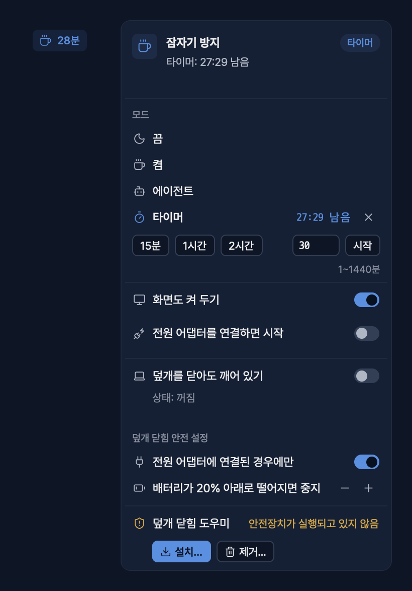

# herdr-caffeinate

[한국어](README.ko.md)

A [Herdr app](https://herdr.dev) mod that keeps your Mac awake on demand: always, while a Herdr agent is working, or
for a set time, optionally with the display on, and optionally with the lid closed. It brings Orca's keep-awake,
Amphetamine's sessions and the closed-lid mode of Amphetamine and Vorssaint into Herdr, as one coffee chip and a menu.
Closing the lid is guarded by safety cut-offs and by a root fail-safe that turns sleep back on when Herdr dies, so the
Mac is never left unable to sleep.



*The chip (left) and its menu, in Korean, during a 30-minute timer with the display kept on. The closed-lid helper is
not installed yet ("fail-safe not running"), so the menu offers Install.*

## What it does

**Modes.** Pick one in the menu, with a key, or from a script.

| Mode | Keeps the Mac awake |
|---|---|
| Off | never: the Mac sleeps as usual |
| On | until you turn it off |
| Agent | while at least one local Herdr terminal has an agent with status `working`, and 30 s after the last one stops (`agent.lingerSec`) |
| Timer | for 15 min, 1 h, 2 h or any number of minutes from 1 to 1440; the chip and the menu show the time left, and the mode returns to Off at the end |

While a mode keeps the Mac awake, the mod runs one process, as Orca does:
`/usr/bin/caffeinate -i -s -w <Herdr pid>`. `-i` stops idle sleep, `-s` stops system sleep (macOS honors it on the
power adapter only), and `-w` ends the process when Herdr exits, even after a crash or `kill -9`. A timer session adds
`-t <seconds left>`, so it ends on time even if the mod stops looking. The mode is saved and comes back when Herdr
starts again; a timer comes back only while its end is still ahead.

**Display.** "Keep the display on" adds `-d` to that process, so the screen does not dim or turn off either. Off by
default.

**Closed lid.** "Stay awake with the lid closed" works like Amphetamine's Closed-Display Mode and Vorssaint: while the
mode keeps the Mac awake, the mod sets `pmset -a disablesleep 1`, so closing the lid does not put the Mac to sleep; when
the mode stops keeping it awake, or you turn the switch off, it sets `disablesleep 0` again. Plain `caffeinate` cannot
do this: closing a MacBook's lid sleeps it whatever caffeinate asks, unless an external display is in use. Closed-lid
needs a one-time setup with your admin password ([Closed-lid setup](#closed-lid-setup)). The menu shows its status:
Off, On, Paused (with the reason), Unavailable (not set up, or the setting could not be changed) or Set by another app.

**Safety.** Closed-lid runs on the power adapter only by default, pauses below 20 % battery and when the Mac runs hot,
puts the Mac to sleep when it ends while the lid is shut, and a root fail-safe turns sleep back on within about a
minute when Herdr dies or hangs, and below 10 % battery. Details: [Safety](#safety).

**Power adapter trigger.** With "Start when the power adapter is connected" on, plugging in starts a session (On, or
Agent with `trigger.ac.mode`). Unplugging ends only a session the adapter started. Turning it Off by hand while plugged
in keeps it off until the next unplug.

**Chip, menu and commands.**

- The chip: a coffee cup that is muted while the Mac may sleep and turns to the accent color while it is kept awake. A
  small dot marks closed-lid: accent while it is on, amber while it is paused, unavailable or set by another app. With
  72 px or more of width it adds words: the minutes left of a timer, else the mode. Its tooltip says all of it.
- The menu (click the chip, or ⌘⇧A anywhere): the four modes, timer presets and a minutes field, the time left with a
  cancel button, the display switch, the power adapter switch, the closed-lid switch with its status and the reason it
  is paused, the closed-lid safety settings (power adapter only, battery floor in 5 % steps), and the closed-lid helper's
  state with Install… and Uninstall….
- Every action is a command for keys, other mods and scripts: `herdr-app do herdr-caffeinate.mode:on`
  ([Commands](#commands)).
- In the [lazuli](https://github.com/Lapis0875/herdr-lazuli) layout the chip appears in the status bar by itself once
  this mod is installed, and lazuli's palette lists the commands.

**Korean and English.** The macOS language decides (Korean → Korean, anything else → English); the `language`
setting overrides it.

## Requirements

| | |
|---|---|
| macOS | built and used on macOS 27, Apple silicon (MacBook) |
| [Herdr app](https://herdr.dev) | 0.1.16, with `herdr-app` on `PATH` for the install steps |
| An admin account | only for closed-lid: its one-time setup runs `sudo` |
| `jq` | optional, for merging the key in install step 3 |
| [Node.js](https://nodejs.org) | only for the tests (`npm test`); built with 26.13 |

The mod itself needs nothing else: every program it runs ships with macOS
([What it runs, reads and writes](#what-it-runs-reads-and-writes)).

## Install

Paths below assume the Herdr app's home is `~/.config/herdr-app` (`HERDR_APP_HOME` otherwise). The name is fixed: the
mod must be `mods/herdr-caffeinate`.

1. In a copy of this repository, make sure nothing is overwritten:

   ```sh
   APP=~/.config/herdr-app
   [ -e "$APP/mods/herdr-caffeinate" ] && echo "already there: $APP/mods/herdr-caffeinate"
   ```

   If that prints anything, stop: another copy is installed.

2. Copy the mod, **`mod.json` first**:

   ```sh
   mkdir "$APP/mods/herdr-caffeinate"
   cp mods/herdr-caffeinate/mod.json "$APP/mods/herdr-caffeinate/"
   cp -R mods/herdr-caffeinate/ "$APP/mods/herdr-caffeinate/"
   ```

   The first time Herdr sees a mod folder it docks one copy of the mod into the layout on screen, unless its `mod.json`
   says `"place": "none"`. If `main.js` lands before `mod.json`, Herdr docks a 320 px block of herdr-caffeinate into
   that layout and rewrites the layout file. If that happened, remove the block
   `{ "mod": "herdr-caffeinate", "size": { "px": 320 } }` from the file in `$APP/layouts/`.

3. Add the key: merge this repository's `keys.json` into yours. It has one entry, ⌘⇧A (`cmd-shift-a`) →
   `mod.open:herdr-caffeinate` in the `global` section, which opens the menu in any layout. Check that the key is free
   (this prints `null`), then merge with a backup:

   ```sh
   jq '.global["cmd-shift-a"]' "$APP/keys.json"
   cp "$APP/keys.json" "$APP/keys.json.before-caffeinate"
   jq -s '.[0] * .[1]' "$APP/keys.json.before-caffeinate" keys.json > "$APP/keys.json"
   ```

   `*` merges recursively, so your other `global` keys stay. Herdr treats an edited `keys.json` as yours from then on.

4. Show the chip, one of:

   - **lazuli:** nothing to do. On its next start (Herdr start, switching to lazuli, or a lazuli reload) lazuli finds
     `mods/herdr-caffeinate/mod.json`, draws the chip in its status bar and lists the commands in its palette.
   - **Any other layout:** add a 40 px block to a row of the layout file, for example a top bar or a status bar:

     ```json
     { "id": "caffeinate", "type": "block", "size": { "px": 40 }, "content": { "mod": "herdr-caffeinate" } }
     ```

     [RECIPE.md](RECIPE.md) shows where it fits and what a wider block shows.

   The chip, or lazuli, keeps the mod's engine running. In a layout with neither, ⌘⇧A opens the menu, which starts the
   engine until the next layout switch ([Safety](#safety) says what happens in between).

5. Check the mod:

   ```sh
   herdr-app check ~/.config/herdr-app/mods/herdr-caffeinate
   ```

6. Try it, with the chip shown:

   ```sh
   herdr-app do herdr-caffeinate.mode:on
   pgrep -lf "^/usr/bin/caffeinate -i -s.* -w $(pgrep -x Herdr)( |$)"
   pmset -g assertions | grep -A2 caffeinate
   herdr-app do herdr-caffeinate.mode:off
   ```

   `pgrep` shows one holder; `pmset -g assertions` lists `PreventUserIdleSystemSleep` and `PreventSystemSleep` for it.
   Other apps may run their own `caffeinate` (Orca does, with `-w <Orca pid>`); only the one with `-w <Herdr pid>` is
   this mod's.

## Closed-lid setup

Closed-lid changes a system setting, `pmset -a disablesleep`, which needs root. The mod never asks for a password: it
only runs `sudo -n` (non-interactive) with the exact two commands one sudoers rule allows. A one-time installer puts
that rule and a root fail-safe in place.

### Install the helper

Press **Install…** in the menu (or `herdr-app do herdr-caffeinate.install`). Herdr opens a tab named
`herdr-caffeinate install` that runs `bin/install.sh` as you; `sudo` asks for your admin password **once**. You can also
run it yourself: `/bin/sh ~/.config/herdr-app/mods/herdr-caffeinate/bin/install.sh`. It refuses to run as root.

What it does, in order:

1. **Checks** your user name (`^[a-z_][a-z0-9_-]*$`, the only characters it will write into a sudoers rule) and your
   home (`/Users/<name>`, a real directory you own), before the first `sudo`.
2. **sudoers rule.** Renders `bin/sudoers.tmpl` with your user name into a temporary file, checks it with
   `visudo -cf`, installs it as `/etc/sudoers.d/herdr-caffeinate` (root:wheel 0440) through a name with a dot (sudo
   skips such names, so it never reads a half-written file), then verifies what it installed: our file alone with
   `sudo visudo -cf /etc/sudoers.d/herdr-caffeinate`, and the rule with `sudo -n -l /usr/bin/pmset -a disablesleep 0`
   and `… 1` (sudo grants both without a password). If any of these fails, it removes the file again. Last, it runs
   `sudo visudo -c` over every sudoers file only to show what that reports about other apps' files, as `note:` lines;
   these never stop the install. For example, Amphetamine's Power Protect installs
   `/private/etc/sudoers.d/amphetamine_PowerProtect` with mode 0644, so `visudo -c` reports
   `bad permissions, should be mode 0440` and fails, while sudo itself still reads that file. Our file holds exactly
   one line:

   ```
   <you> ALL = (root) NOPASSWD: /usr/bin/pmset -a disablesleep 0, /usr/bin/pmset -a disablesleep 1
   ```

   sudo compares arguments exactly, so this allows these two commands and nothing else: not other `pmset` arguments,
   not another user.
3. **Fail-safe helper.** Copies `bin/failsafe.sh` to
   `/Library/PrivilegedHelperTools/io.github.lapis0875.herdr-caffeinate.failsafe` (root:wheel 0755) and creates
   `/var/db/herdr-caffeinate/` (root:wheel 0755). The daemon runs this root-owned copy, never the file in your mod
   folder.
4. **LaunchDaemon.** Renders `bin/failsafe.plist.tmpl` with your home, checks it with `plutil -lint`, installs it as
   `/Library/LaunchDaemons/io.github.lapis0875.herdr-caffeinate.failsafe.plist` (root:wheel 0644), then
   `launchctl bootout` (an old copy; errors ignored), `launchctl enable` and `launchctl bootstrap system` it. The daemon
   runs `/bin/sh <helper> /Users/<you>/.herdr/herdr-caffeinate/claim` at load and every 15 s.
5. **Waits** up to 30 s until the fail-safe has touched `/var/db/herdr-caffeinate/alive`.

The tab ends with `[exit N] Press Enter to close.`

| Exit | Meaning |
|---|---|
| 0 | installed |
| 1 | refused: run as root, a user name or home it will not use, or a missing file |
| 2 | wrong arguments |
| 10 | the sudoers step failed: the password was refused, our file did not pass `visudo -cf`, or `sudo -n -l` refused one of the two commands; our file was removed |
| 20 | the helper or `/var/db/herdr-caffeinate` could not be installed |
| 30 | the plist or the daemon failed, or the fail-safe did not report alive within 30 s |

After 20 or 30, run the uninstaller to remove what was installed. Running the installer again is safe; it replaces
every file.

**"Background Items Added".** When the daemon is loaded, macOS shows this notice, and the daemon appears in System
Settings → General → Login Items & Extensions, under "Allow in the Background". Leave it allowed: turned off, the
fail-safe stops, and closed-lid shows Unavailable until it runs again.

The menu then shows the helper as Installed. It reports two facts (shared state `install`): `sudo`, that
`sudo -n -l /usr/bin/pmset -a disablesleep 0` and `… 1` both succeed, and `failsafe`, that `alive` is at most 60 s old.
Closed-lid needs both.

### Files outside the Herdr app's home

| Path | Owner, mode | What it is |
|---|---|---|
| `~/.herdr/herdr-caffeinate/` | you, 0700 | the mod's runtime folder |
| `~/.herdr/herdr-caffeinate/claim` | you, 0600 | exists while your Herdr holds `disablesleep 1`; its modification time is the heartbeat the fail-safe checks (touched every 10 s); its content `{v:1, owner:{pid, appHome}, since}` is read only by the mod |
| `~/.herdr/herdr-caffeinate/released` | you, 0600 | touched by the mod after its own closed-lid off read back `SleepDisabled 0`, just before it removes the claim; removed by the mod before it writes a new claim; the fail-safe reads only its modification time; the uninstaller removes it |
| `~/.herdr/herdr-caffeinate/engine` | you, 0600 | reserved for a keeper fallback that this version does not use ([docs/spikes/S3.md](docs/spikes/S3.md)); never created |
| `/etc/sudoers.d/herdr-caffeinate` | root:wheel 0440 | the sudoers rule above |
| `/Library/PrivilegedHelperTools/io.github.lapis0875.herdr-caffeinate.failsafe` | root:wheel 0755 | the root copy of `bin/failsafe.sh` |
| `/Library/LaunchDaemons/io.github.lapis0875.herdr-caffeinate.failsafe.plist` | root:wheel 0644 | the LaunchDaemon `io.github.lapis0875.herdr-caffeinate.failsafe` |
| `/var/db/herdr-caffeinate/{alive,armed,handled,last-restore}` | root, folder 0755, files 0644 | the fail-safe's state, readable by everyone: `alive` touched every run; `armed` while it has seen `disablesleep 1` under a fresh claim; `handled` the stale claim it already restored; `last-restore` `<epoch> <reason>` |

### Uninstall the helper

Press **Uninstall…** in the menu (or `herdr-app do herdr-caffeinate.uninstall`, or
`/bin/sh ~/.config/herdr-app/mods/herdr-caffeinate/bin/uninstall.sh`). It runs as you and uses `sudo` for each step:

1. If `~/.herdr/herdr-caffeinate/claim` exists, or `/var/db/herdr-caffeinate/armed` exists without a
   `~/.herdr/herdr-caffeinate/released` at least as new (closed-lid may be on), and `SleepDisabled` does not read 0, it
   runs `sudo pmset -a disablesleep 0`. A `released` at least as new as `armed` means the mod already turned sleep back
   on itself, so a `SleepDisabled 1` now is another tool's and stays.
2. `sudo launchctl bootout system/io.github.lapis0875.herdr-caffeinate.failsafe`.
3. Removes the plist, the helper, `/var/db/herdr-caffeinate/` and `/etc/sudoers.d/herdr-caffeinate`, then, as you without
   `sudo`, `~/.herdr/herdr-caffeinate/claim` and `~/.herdr/herdr-caffeinate/released` (only those files; a symlink is
   removed itself, never its target). Left behind, a stale claim would make a later install's fail-safe turn off a
   `disablesleep 1` set by another tool.
4. Checks that the daemon is gone (`launchctl print`) and that no path is left, `/etc/sudoers.d/herdr-caffeinate`, the
   claim and `released` included. A whole-config `sudo visudo -c` follows only to print what it reports about other apps' sudoers files
   as `note:` lines (such as Amphetamine's 0644 file above); it never changes the exit code.
5. If `SleepDisabled` still reads 1, another tool set it; it says so and leaves it (`sudo pmset -a disablesleep 0`
   clears it).

| Exit | Meaning |
|---|---|
| 0 | everything removed |
| 1 | refused: run as root, or a user name or home it will not use |
| 40 | something is left, or the `disablesleep 0` restore failed; the messages above say what |

The macOS item under "Allow in the Background" goes away with the daemon. `~/.herdr/herdr-caffeinate/` stays (empty
once the uninstaller has removed the claim and `released`); remove it with `rm -r ~/.herdr/herdr-caffeinate`.

## Commands

Through keys, another mod's `run()`, or `herdr-app do herdr-caffeinate.<command>`. `herdr-app do` prints `{"ok": true}`;
it reaches the mod only while a copy is shown (the chip, lazuli's hidden host, or the open menu), and otherwise exits 1
with "need the mod loaded". An unknown or malformed command changes nothing and logs one line.

| Command | What it does |
|---|---|
| `toggle` | Off ↔ the last of On and Agent (On the first time) |
| `mode:off`, `mode:on`, `mode:agent` | that mode |
| `timer:<minutes>` | a timer of 1 to 1440 minutes (`timer:0`, `timer:1441`, `timer:abc` do nothing) |
| `timer:cancel` | ends the timer at once |
| `display:on`, `display:off`, `display:toggle` | keep the display on |
| `closed-lid:on`, `closed-lid:off`, `closed-lid:toggle` | stay awake with the lid closed |
| `menu` | opens the menu and reads the power state at once |
| `refresh` | reads `settings.json` again, reads the power state, and applies both at once |
| `install`, `uninstall` | opens a Herdr tab running `bin/install.sh` or `bin/uninstall.sh` |

| Key | Action | What it does |
|---|---|---|
| ⌘⇧A `cmd-shift-a` (`global`) | `mod.open:herdr-caffeinate` | opens the menu, in any layout |

`display:*` and `closed-lid:*` change the setting at any time; they take effect while a mode keeps the Mac awake.

## Settings

The menu writes `data/herdr-caffeinate/settings.json` in the Herdr app's home. You can edit it by hand too: the mod
reads it again on every check (every 10 to 30 s while active), when the menu opens, and at once after
`herdr-app do herdr-caffeinate.refresh`. A missing or invalid field takes its default; fields it does not know are
kept.

| Field | Default | Meaning |
|---|---|---|
| `language` | `"system"` | `"system"`, `"ko"` or `"en"`; `system` follows the first language in macOS's preferred languages |
| `mode` | `"off"` | `"off"`, `"on"`, `"agent"` or `"timer"`; kept across restarts |
| `display` | `false` | keep the display on too (`caffeinate -d`) |
| `timer.presetsMin` | `[15, 60, 120]` | the preset buttons, 1 to 8 values of 1 to 1440 minutes |
| `timer.lastCustomMin` | `45` | the minutes field's value |
| `agent.lingerSec` | `30` | seconds Agent mode stays awake after the last agent stops working (0 to 3600) |
| `agent.includeRemote` | `false` | count agents on other machines too |
| `closedLid.enabled` | `false` | stay awake with the lid closed |
| `closedLid.acOnly` | `true` | closed-lid only on the power adapter |
| `closedLid.batteryFloor` | `20` | pause closed-lid below this battery %, clamped to 10 to 90 |
| `trigger.ac.enabled` | `false` | plugging in the power adapter starts a session |
| `trigger.ac.mode` | `"on"` | the mode that session runs in: `"on"` or `"agent"` |
| `debug` | `false` | checks every 10 s, and allows `fake` |
| `fake` | none | only with `debug: true`: `{ "ac", "percent", "thermal", "lidClosed" }` replace what the mod reads from the Mac, for testing the safety rules |

The mod also writes, in the same folder: `runtime.json` (the running session and its end, the holder's pid and command,
the power adapter trigger's state, and the last of On/Agent that `toggle` returns to) and `state.json` (a copy of the
shared state below, for scripts:
`jq . ~/.config/herdr-app/data/herdr-caffeinate/state.json`).

Other mods read the shared key `herdr-caffeinate.state`:

```json
{ "v": 1, "at": 1763568000000, "mode": "off|on|agent|timer", "active": true,
  "reason": "user|agent|timer|trigger|null", "display": false, "endsAt": null,
  "closedLid": { "wanted": false, "status": "off|engaged|blocked|unavailable|external",
    "blocked": "ac|battery|thermal|unknown|other-instance|null" },
  "install": { "sudo": true, "failsafe": true } }
```

## Safety

**Plain keep-awake** (`caffeinate`) needs no privilege and cannot outlive Herdr: `-w <Herdr pid>` ends it within
seconds when Herdr exits, crashes or is killed. The mod kills a holder only after `ps` shows exactly the command it
started, and at start it ends any leftover holder of the same Herdr (a reload that lost track of one), so at most one
runs.

**Closed-lid** runs only while a mode keeps the Mac awake, and is paused (status Paused, reason shown) when:

| Cut-off | Default | Clears |
|---|---|---|
| on battery while `closedLid.acOnly` is on | on | on the power adapter |
| battery below `closedLid.batteryFloor` | 20 % | at floor + 5 %, or on the power adapter |
| macOS thermal state serious (2) or critical (3) | always | after two checks in a row at fair (1) or below |
| the power state cannot be read three checks in a row | always | at the next good read |
| another Herdr on this Mac holds closed-lid | always | when it lets go |

While closed-lid is On, the mod checks every 10 s. The thermal state is read only while the closed-lid switch is on.

- **The lid shut sleeps the Mac unless closed-lid is on (D7).** While the lid is closed, macOS would sleep on a closed
  lid (`AppleClamshellCausesSleep` is Yes) and closed-lid is not on (switched off, paused, unavailable or set by another
  app), no mode holds the Mac awake: the mod stops its caffeinate holder, because the holder's `PreventSystemSleep`
  would turn that sleep into a dark wake on the power adapter. When closed-lid ends for any reason with the lid shut,
  the mod stops the holder and waits until it has exited, turns `disablesleep` back to 0 and then runs
  `pmset sleepnow`. While a session waits with the lid shut the mod checks every 10 s, and a check missed while the Mac
  slept runs as soon as it wakes. When the lid is open again, or `AppleClamshellCausesSleep` reads No (clamshell mode
  with an external display), keep-awake follows the mode again, within 10 s of opening the lid. The mode and a timer
  keep running meanwhile; the chip and the shared state show the Mac as not kept awake.
- **Read back.** Every `disablesleep` change is read back from `pmset -g`. If `disablesleep 1` does not take, the mod
  sets 0 again, removes its claim and shows Unavailable.
- **Root fail-safe.** While closed-lid is on, the mod keeps a claim file fresh (every 10 s). The fail-safe, run by
  launchd as root every 15 s, arms itself when it sees `SleepDisabled 1` under a fresh claim, and runs
  `pmset -a disablesleep 0` (when `SleepDisabled` reads 1) when:
  - the claim is older than 45 s (Herdr died, hung or was stopped with `kill -STOP`): sleep is back within about 60 s
    of the last heartbeat. In the first 60 s after a wake it waits, so a Mac that just woke is not cut off before Herdr
    catches up;
  - the claim disappears while it is armed, unless the mod turned closed-lid off itself: the mod touches
    `~/.herdr/herdr-caffeinate/released` after its own `disablesleep 0` reads back, and a `released` at least as new as
    the arm only disarms the fail-safe;
  - it is armed and the Mac runs on battery below **10 %**, even if Herdr is frozen.

  If the lid is shut and macOS would sleep on a closed lid, it also runs `pmset sleepnow`. It writes the time and
  reason to `/var/db/herdr-caffeinate/last-restore` (`stale-claim`, `claim-gone` or `battery-floor`).
- **Another tool's setting is left alone.** With no claim and nothing armed, or with no claim after the mod released
  closed-lid itself, the fail-safe never changes `SleepDisabled`, so a `disablesleep 1` another tool sets right after
  closed-lid goes off stays; and the mod never sets it while another tool already has it at 1: the status shows Set by
  another app.
- **Sleep turned back on outside Herdr.** If `SleepDisabled` returns to 0 while closed-lid is on and the fail-safe did
  not do it (for example `sudo pmset -a disablesleep 0` in a terminal), the mod turns the closed-lid setting off and
  says so. If the fail-safe did it and the conditions still hold, the mod turns closed-lid on once more and says so; a
  second time counts as turned off by you.
- **Quitting Herdr** counts as a crash: nothing is released on the way out. The holder ends through `-w`; the
  fail-safe restores sleep within about a minute.
- **A layout without the chip** (and not lazuli) runs no engine. Then closed-lid is restored by the fail-safe within
  about a minute; a timer's holder still ends on time (`-t`); an On or Agent holder stays until the engine runs again
  (show the chip, switch to lazuli, or press ⌘⇧A) or Herdr exits, and Agent mode does not follow agents meanwhile.

## What it runs, reads and writes

This list is derived from the source: every `exec` in `mods/herdr-caffeinate/sys/`, the scripts in
`mods/herdr-caffeinate/bin/` and the programs inside them. Every program is called by its absolute path; arguments are
passed as arguments, never pasted into a shell string.

**Programs the mod runs** (as you, through Herdr's `exec`):

- `/usr/bin/caffeinate -i -s [-d] -w <Herdr pid> [-t <seconds>]`: the holder, started detached through
  `/bin/sh -c 'nohup "$@" >/dev/null 2>&1 & echo "$!"'`, so it outlives the call and a mod reload.
- `/bin/sh -c 'echo "$PPID"; /bin/ps -o command= -p "$PPID"'`: Herdr's pid and command line (the `-w` target, and
  telling another Herdr's claim from ours).
- `/bin/ps -o command= -p <pid>` (is a pid still our holder, or a live Herdr), `/bin/ps -axo pid=,command=` (leftover
  holders, at engine start) and `/bin/kill <pid>` (a holder, after its command line matched).
- `/usr/bin/sudo -n /usr/bin/pmset -a disablesleep 1` and `… 0`: the only privileged commands; `sudo -n` never prompts,
  and a refusal means the rule is not installed. `/usr/bin/sudo -n -l /usr/bin/pmset -a disablesleep 0` and `… 1`
  (lists whether the rule allows them; runs nothing), at start, on commands, when the menu opens and every 5 minutes
  while the closed-lid switch is on.
- `/usr/bin/pmset sleepnow` (no sudo): when closed-lid ends with the lid shut, after the holder has exited:
  `/bin/sh -c` with `/bin/kill -0 <pid>` and `/bin/sleep 0.05`, at most 1 s, waits for that.
- `/bin/sh -c '/usr/bin/pmset -g | /usr/bin/grep SleepDisabled'`: the read-back after each change.
- `bin/probe.sh [--thermal]` through `/bin/sh`, read-only, every check: `/usr/bin/pmset -g batt` (power source and
  battery %), `/usr/bin/pmset -g | /usr/bin/grep SleepDisabled`,
  `/usr/sbin/ioreg -r -k AppleClamshellState -d 1 | /usr/bin/grep -E '"AppleClamshell(State|CausesSleep)"'` (lid
  closed, and whether a closed lid sleeps the Mac), with `--thermal` only while the closed-lid switch is on
  `/usr/bin/osascript -l JavaScript -e 'ObjC.import("Foundation"); $.NSProcessInfo.processInfo.thermalState'`, then
  `/usr/bin/stat -f %m` (the times of `alive`, the claim and `last-restore`) and `/bin/date +%s`.
- The claim, which only `exec` can write outside the app home: first `/bin/rm -f ~/.herdr/herdr-caffeinate/released`
  (a symlink is removed itself, never its target; if that fails, nothing is engaged), then `/bin/sh -c 'umask 077;
  /bin/mkdir -p … && /bin/chmod 700 … && printf … > claim.tmp && /bin/mv -f claim.tmp claim'` (written through a
  rename, which replaces a symlink instead of following it), `/usr/bin/touch -c <claim>` (the heartbeat; never creates
  it) and `/bin/rm -f <claim>`; before that removal, after its own `disablesleep 0` read back 0,
  `/bin/sh -c 'umask 077; /usr/bin/touch "$1"' sh ~/.herdr/herdr-caffeinate/released`.
- `/usr/bin/defaults read -g AppleLanguages`: the system language, once per engine start.
- Install… and Uninstall… open a Herdr tab (`tab.new`) running
  `/bin/sh -c '/bin/sh "$1"; …; read _' sh <app home>/mods/herdr-caffeinate/bin/install.sh` (or `uninstall.sh`).

**The installer and uninstaller** (as you, in that tab): `/usr/bin/id`, `/usr/bin/stat`, `/usr/bin/mktemp`,
`/usr/bin/sed` (rendering the templates), `/usr/sbin/visudo -cf` (the rendered temporary file), `/usr/bin/plutil -lint`,
`/bin/date`, `/bin/sleep`, `/bin/rm` (its temporary folder, and in the uninstaller `~/.herdr/herdr-caffeinate/claim` and `released`), `/usr/bin/pmset -g` (reading `SleepDisabled`),
`/bin/launchctl print` (is the daemon gone), and through `/usr/bin/sudo`: `/usr/bin/install` (each root file with its
owner and mode), `/bin/mv`, `/usr/sbin/visudo -cf /etc/sudoers.d/herdr-caffeinate` (our installed file),
`-n -l /usr/bin/pmset -a disablesleep 0` and `… 1` (does sudo grant the rule; runs nothing), `-n /usr/sbin/visudo -c`
(every sudoers file, for notes only), `/bin/rm`, `/bin/launchctl bootout`, `/bin/launchctl enable`,
`/bin/launchctl bootstrap system`, and in the uninstaller `/usr/bin/pmset -a disablesleep 0`.

**The fail-safe** (as root, run by launchd every 15 s, fixed `PATH`): `/bin/date +%s`, `/usr/bin/touch` (`alive`, `armed`),
`/usr/bin/stat -f %m` (the times of the claim, `released` and `armed`, without following a symlink), `/usr/bin/pmset -g`, `/usr/bin/pmset -g batt`,
`/usr/sbin/sysctl -n kern.waketime` (the last wake), `/usr/sbin/ioreg -r -k AppleClamshellState -d 1`, and to restore:
`/usr/bin/pmset -a disablesleep 0`, `/bin/rm -f` (`armed`), `/usr/bin/pmset sleepnow`.

**Reads**, outside its own folders: the claim's content (`~/.herdr/herdr-caffeinate/claim`, by the mod only), the times
of `/var/db/herdr-caffeinate/alive` and `last-restore`, and Herdr's terminal list for agent status. The fail-safe reads
only the modification times of the claim and of `released`, never their content, and only when each is a regular file, not a symlink.

**Writes:** `data/herdr-caffeinate/{settings,runtime,state}.json` in the Herdr app's home, the shared key
`herdr-caffeinate.state`, the claim and `released` in `~/.herdr/herdr-caffeinate/`, and the system setting `disablesleep`. The
installer writes the root paths in [the table above](#files-outside-the-herdr-apps-home) (and, briefly,
`/etc/sudoers.d/herdr-caffeinate.new` and a temporary folder); the fail-safe writes only under
`/var/db/herdr-caffeinate/`.

**Network:** none.

## Security

The sudoers rule lets any process running as you, not only Herdr, run the two `pmset -a disablesleep` commands without
a password: it can keep your Mac from sleeping with the lid closed, or turn that off. It allows nothing else. The root
fail-safe reads only the modification times of the claim and of `released`, both in one validated folder, never follows
symlinks, never writes in your home, and can only ever turn sleep back on. [SECURITY.md](SECURITY.md) has the threat
notes and how to report a problem.

## Limits

- **macOS only**, built on macOS 27 with Herdr 0.1.16; other versions are untested.
- **`disablesleep` is undocumented** (`man pmset` does not list it) and may change in a macOS update. Every change is
  read back; if it stops working, closed-lid shows Unavailable instead of claiming to be on.
- **`AppleClamshellCausesSleep` can be stale after an external display is unplugged.** macOS re-reads it when the lid
  closes; after unplugging a display with the lid open it can keep reading No (spike S3). If closed-lid ends with the
  lid shut while it still reads No, the mod and the fail-safe skip `pmset sleepnow`, and the Mac stays awake until it
  idles to sleep. With an external display in use on the power adapter, macOS stays awake with the lid shut anyway, and
  closed-lid is not needed.
- **Another tool setting `disablesleep` while closed-lid is on** (for example Amphetamine's Closed-Display Mode) shares
  the same system setting. When closed-lid ends, the mod sets 0, which also ends the other tool's setting; when the
  other tool sets 0, the mod turns closed-lid off. Use one of them at a time.
- **`caffeinate -s` holds only on the power adapter.** On battery, the holder prevents idle sleep only.
- **One Herdr per Mac user** can hold closed-lid; a second one shows Paused ("Another Herdr is using it").
- **A hung Herdr with the lid shut can keep the Mac in dark wake.** The holder ends with the Herdr process (`-w`), not
  with the mod's engine. If Herdr hangs (for example `kill -STOP`) while closed-lid is on and the lid is shut on the
  power adapter, the fail-safe turns sleep back on and runs `pmset sleepnow`, but the holder's `PreventSystemSleep`
  turns that sleep into a dark wake until Herdr resumes (the mod then stops the holder) or exits.
- **Turning closed-lid back on within 15 s of turning it off** leaves a window of a few milliseconds, between removing
  `released` and writing the claim, in which the fail-safe can take the claim as lost. It then writes `last-restore` (and
  runs `pmset sleepnow` if the lid is shut and macOS would sleep on a closed lid), and a `disablesleep 0` you set by hand
  later may be taken for the fail-safe's, so the mod turns closed-lid on once more.
- **If that re-engage cannot write the claim** and another tool sets `disablesleep 1` before the next fail-safe run (at
  most 15 s later), the fail-safe turns that setting off.
- **Right after the Mac wakes, the fail-safe can look missing.** launchd skips its 15 s runs while the Mac sleeps, so
  its heartbeat can read as too old and the menu may briefly show "Fail-safe not running"; it recovers within one run.
- **Local only.** Remote Herdr machines are not kept awake; their agents count for Agent mode only with
  `agent.includeRemote`.
- **Commands need a shown copy.** `herdr-app do herdr-caffeinate.*` fails while no chip, lazuli host or menu is shown.

## Uninstall

1. If you set up closed-lid, run its uninstaller first ([Uninstall the helper](#uninstall-the-helper)) while the mod is
   still there.
2. Turn the mode Off (`herdr-app do herdr-caffeinate.mode:off`), so no holder is left until Herdr exits.
3. Remove the chip's block from your layouts, then the files:

   ```sh
   APP=~/.config/herdr-app
   rm -r "$APP/mods/herdr-caffeinate"
   rm -rf ~/.herdr/herdr-caffeinate
   ```

4. Remove the `cmd-shift-a` entry from the `global` section of `keys.json`, by hand or with
   `jq 'del(.global["cmd-shift-a"])'`.
5. `data/herdr-caffeinate/` in the Herdr app's home holds your settings; delete it with
   `rm -r ~/.config/herdr-app/data/herdr-caffeinate` once you no longer want them. lazuli stops drawing the chip at its
   next start.

## Development

[RECIPE.md](RECIPE.md) describes how the mod is built, how to wire it into a layout or another mod, and how to work on
it. The acceptance scenarios and spike results are in [docs/TESTING.md](docs/TESTING.md), the contracts in
[docs/CONTRACTS.md](docs/CONTRACTS.md). Changes are listed in [CHANGELOG.md](CHANGELOG.md).

## Credits

- [Orca](https://github.com/stablyai/orca): the keep-awake through a `caffeinate -i -s -w` child process.
- [Amphetamine](https://apps.apple.com/app/amphetamine/id937984704) and its
  [Enhancer](https://github.com/x74353/amphetamine-enhancer): closed-display mode and the idea of a root fail-safe.
- [Vorssaint](https://github.com/vorssaint/vorssaint-utils): closed-lid keep-awake and sleeping after it ends.
- [Lucide](https://github.com/lucide-icons/lucide): the icons, under their licence in
  `mods/herdr-caffeinate/ui/icons/LICENSE-Lucide.txt`.

## License

MIT © 2026 Lapis0875, see [LICENSE](LICENSE).
