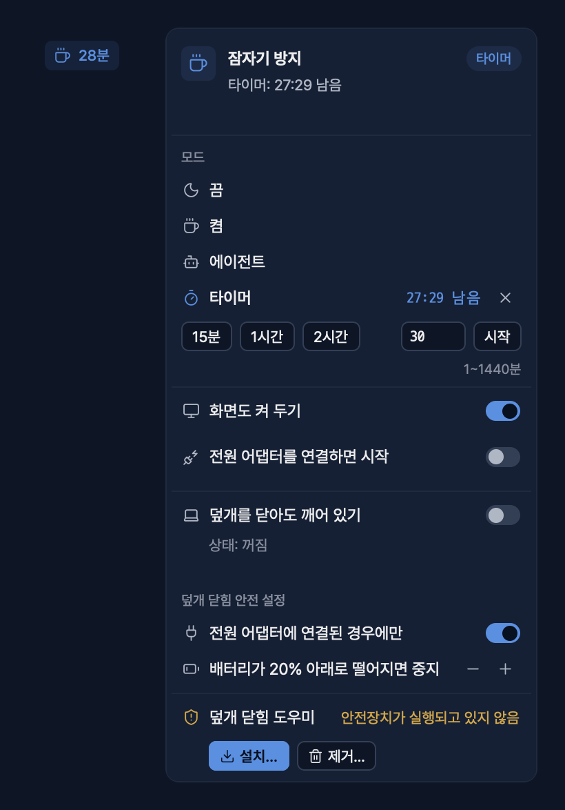

# herdr-caffeinate

herdr-caffeinate is a Herdr app mod that keeps the Mac awake on demand, lid closed included. This file is its
developer guide: how to wire it into a layout or another mod, how it is put together, and how to work on it. What it
does for the person is in [README.md](README.md); the contracts it was built to are
[docs/CONTRACTS.md](docs/CONTRACTS.md) (IDs such as C3), the acceptance scenarios and spike results are
[docs/TESTING.md](docs/TESTING.md), and the privilege model is [SECURITY.md](SECURITY.md).



## Wiring it into a layout

### A block in any layout

The mod's `mod.json` says `"place": "none"`, so Herdr never docks it by itself: a layout puts it where it belongs. A
block whose content is the mod with no `view` prop draws the chip:

```json
{ "id": "caffeinate", "type": "block", "size": { "px": 40 }, "content": { "mod": "herdr-caffeinate" } }
```

- **Where.** A row of fixed height: a top bar beside the tabs, a status bar, a sidebar footer. The chip, a button,
  centers itself in the block, so the block may be wider than the chip.
- **How wide.** 40 px shows the coffee cup and the closed-lid dot. From 72 px on, the chip adds words: the minutes left
  of a timer ("28 min"), else the mode. The tooltip always says everything.
- **What it starts.** A chip copy starts the engine and opens the hidden host window (below) when none is open. So one
  chip in the shown layout is enough to keep keep-awake, the timer, Agent mode and the closed-lid heartbeat running,
  and to let `herdr-app do herdr-caffeinate.<command>` reach the mod.
- **Several chips** (two layouts, or two blocks) are fine: the engine is one module-scope singleton, every copy draws
  the same state, and only the first-registered live copy acts on a command.
- `"props": { "view": "chip" }` is the same as no props; `view` can also be `menu` (the popover) or `host` (the hidden
  window), which a layout has no reason to place.

Herdr starts a layout's mods fresh when the layout shows, so each layout that should keep the engine running needs
its own chip. In a layout without one, ⌘⇧A (`mod.open:herdr-caffeinate`) opens the menu; the menu opens the host,
which runs the engine until the next layout switch closes it. README's [Safety](README.md#safety) says what happens
while no engine runs.

### From another mod (lazuli's way)

lazuli draws herdr-caffeinate's chip in its own status bar without importing anything from this mod. Another layout
mod can do the same:

1. **Find it.** On every start of your services (layout start, a switch back to your layout, a reload), check
   `fs.exists("<app home>/mods/herdr-caffeinate/mod.json")`. Absent: draw nothing, list nothing, log nothing.
2. **Open the host.** Present: open the hidden host window, exactly this spec, without `keep`:

   ```js
   openOverlay({ mod: "herdr-caffeinate", props: { view: "host" }, kind: "window", frame: "none",
     key: "herdr-caffeinate.host", width: 2, height: 2, at: { x: 0, y: 0 } });
   ```

   It stays open, cannot be seen, runs the engine and receives `herdr-app do herdr-caffeinate.<command>`. Opening the
   same `key` again replaces it, so reopen it on every start rather than keeping it: a layout switch closes windows,
   and a kept window would come back and replace yours. The host stops presses, so it is never dragged by accident
   ([docs/spikes/S2.md](docs/spikes/S2.md)).
3. **Read the state.** `shared("herdr-caffeinate.state")` is the C3 object (README, [Settings](README.md#settings)). It
   is published when the engine starts and when something changes, never per tick. Treat a value whose `v` is not 1,
   or whose `at` is older than your host open, as "starting". `active` says whether the Mac is held awake, `reason`
   why, `endsAt` when a timer ends (count the minutes down yourself), `closedLid.status` and `closedLid.blocked` the
   closed-lid state, `install` whether the helper is set up.
4. **Act through commands.** `run("herdr-caffeinate.menu")` opens the menu at the pointer; any C1 command works the
   same way (`run("herdr-caffeinate.mode:on")`, `run("herdr-caffeinate.timer:60")`). lazuli's palette offers `menu`,
   `toggle`, the three modes, the three presets, `timer:cancel`, `display:toggle`, `closed-lid:toggle`, `install` and
   `uninstall`.

lazuli's side of this is `mods/lazuli/sys/caffeinate.js` and `mods/lazuli/core/caffeinate-chip.js` in the layout's
repository.

### From scripts

```sh
herdr-app do herdr-caffeinate.timer:45          # {"ok": true}
jq '{mode, active, endsAt, lid: .closedLid.status}' ~/.config/herdr-app/data/herdr-caffeinate/state.json
```

`herdr-app do` reaches the mod only while one of its copies is shown; otherwise it exits 1 with "need the mod loaded".
`state.json` is the last published C3 object. Settings edited by hand apply within one check, or at once after
`herdr-app do herdr-caffeinate.refresh`.

## Built from

### The mod

| Path | What it holds |
|---|---|
| `mod.json` | `"place": "none"`, and the overlay `mod.open` uses: a frameless popup, 300 × 649 (the menu's tallest case) |
| `main.js` | the `VIEWS` registry: `props().view` picks `chip`, `menu` or `host`; without one, an overlay is the menu and a block is the chip |
| `core/` | pure logic, no `herdr`, `gpui-kit` or `fs/promises` imports, no clock, no randomness (the purity test enforces it): `state.js` (names, C2 settings, runtime state, C1 command parsing, the C3 object), `machine.js` (the C10 reducer `step`), `probe-parse.js` (C5), `format.js` (time left), `i18n.js` |
| `core/catalog/` | the UI text, one `<area>.en.js` and `<area>.ko.js` pair per area: `chip`, `error`, `install`, `lid`, `menu`, `mode`, `timer`, `toast` |
| `sys/` | the engine and its I/O: `index.js` (binds the engine to Herdr; the host and menu overlay specs), `engine.js` (the singleton: cycle, ticks, commands, publishing), `holder.js` (the `caffeinate` holder), `closed-lid.js` (the claim, engage and disengage), `privilege.js` (`sudo -n`), `probe.js` (runs `bin/probe.sh`), `agents.js` (working agents), `store.js` (the three JSON files) |
| `views/` | `chip.js`, `menu.js`, `host.js`; `describe.js` (words and looks for a snapshot), `parts.js` (copy plumbing and small UI parts) |
| `ui/` | `tokens.js` (the only module that reads `theme()`, `settings()` and `fonts()`), `icons.js`, `icons/*.svg` (Lucide, with `LICENSE-Lucide.txt`) |
| `bin/` | POSIX `sh` only: `probe.sh` (C5, read-only), `install.sh` and `uninstall.sh` (C8), `failsafe.sh` (the root watchdog, C7), `sudoers.tmpl` (C6), `failsafe.plist.tmpl` (C7) |

### How the pieces meet

- **One engine, many copies.** Herdr runs a copy of the mod for every block and overlay, but module scope is shared.
  The engine in `sys/index.js` is a module-scope singleton; copies attach to it with a role (`host`, `chip`, `menu`)
  and draw its snapshot.
- **Who runs it.** A host or chip copy starts the engine in `init` (not under `herdr-app check`). Its timers are
  `{owner: null}`, which still stop when the copy that started them closes ([docs/spikes/S2.md](docs/spikes/S2.md)),
  so the engine records its starting copy; that copy's `close()` marks it stopped, and the next host or chip render
  restarts it from `runtime.json` and `settings.json`. Menu copies never start it: they open the host.
- **The cycle.** A tick, a poke (every render, debounced 250 ms), a command or a menu open runs: re-read
  `settings.json` when its text changed → probe (`bin/probe.sh`, on ticks, commands, menu and `refresh`) → `step` →
  reconcile the holder → reconcile closed-lid → touch the claim → write `runtime.json` → publish C3 when it changed.
  Ticks run every 10 s while the claim is held or `debug` is on, every 30 s while a session runs or the AC trigger is
  on, and not at all otherwise.
- **Commands.** Every shown copy receives each `herdr-caffeinate.<command>` through `nextCommand()`; the engine lets
  only the first-registered live copy act, and runs a command only later copies received once after 300 ms.
- **The holder** is started detached with `nohup` from an `exec`'d `/bin/sh`, because `exec` waits for its process to
  exit; `$PPID` of that shell is Herdr's pid, the `-w` target ([docs/spikes/S1.md](docs/spikes/S1.md)). Its pid and
  argv go into `runtime.json`, and a reloaded engine adopts it after `ps` confirms the argv.
- **Closed-lid** writes the claim through `exec`, since `fs/promises` writes only under the app home, then
  `sudo -n pmset -a disablesleep 1`, and reads the result back. Disengaging runs the reverse, then `pmset sleepnow`
  when the reducer asks for it.
- **Close releases nothing.** Quitting Herdr is treated like a crash: `-w` ends the holder, and the root fail-safe
  ends closed-lid.

## Working on it

### Run it from the repository

During development `~/.config/herdr-app/mods/herdr-caffeinate` can be a symlink to this repository's
`mods/herdr-caffeinate`, so Herdr runs the working copy (`mod.json` and `main.js` appear together through the link,
so Herdr does not dock it). Herdr loads a mod again when one of its files is saved, and every copy reloads in place;
the engine then adopts its holder from `runtime.json`. Remove the symlink before installing a real copy.

The installer copies `bin/failsafe.sh` into a root path, so a change to it takes effect only after running
`bin/install.sh` again.

### Tests

```sh
npm test                                # node --test tests/
node --test tests/machine.test.mjs      # one file
node --test --test-name-pattern sleepNow tests/
```

| File | Covers |
|---|---|
| `purity.test.mjs` | `core/` imports only `core/`, and reads no clock or randomness |
| `machine.test.mjs` | the reducer: modes, timer and linger boundaries, every closed-lid block and its clearing, `sleepNow`, the AC trigger |
| `state.test.mjs`, `format.test.mjs` | settings normalization, runtime state, command parsing, the C3 object, time formats |
| `probe-parse.test.mjs` | `parseProbe` on real outputs captured on macOS 27 (`tests/fixtures/probe/`) and on garbage |
| `i18n.test.mjs` | both languages have the same keys and placeholders |
| `engine.test.mjs` | the engine with fake `exec` and files: one holder at most, adoption, orphan cleanup, `-t` on timers, engage and disengage order, read-back failure, `external`, `fake` facts, restart after its copy closes |
| `failsafe.test.mjs` | `bin/failsafe.sh` against fake `pmset`, `ioreg` and `sysctl`: stale, gone and fresh claims, wake grace, battery floor, symlinks, bad arguments, no clobbering, absolute paths |
| `install.test.mjs` | the rendered sudoers line (byte for byte, `visudo -cf`) and plist (`plutil -lint`), hostile user names, refusing root |

### `herdr-app check`

```sh
herdr-app check ~/.config/herdr-app/mods/herdr-caffeinate
```

It loads the mod once with empty shared state and checks its first render. The engine does not start under it
(`checking()`), so it runs no program. A passing check is necessary, not sufficient: run the live scenarios of
[docs/TESTING.md](docs/TESTING.md) too.

### Live checks without unplugging anything

With `"debug": true` in `settings.json`, the engine ticks every 10 s and honors `fake`, which replaces what the probe
read: `{ "ac": false, "percent": 19, "thermal": 2, "lidClosed": true }`. Edit, then run
`herdr-app do herdr-caffeinate.refresh`, then read `state.json`. Remove `fake` and set `debug` back to `false`
afterwards.

### Add UI text

1. Pick the area (`chip error install lid menu mode timer toast`) and add the key to both `core/catalog/<area>.en.js`
   and `<area>.ko.js`. Keys start with the area: `"lid.block.thermal"`.
2. Use the same `{name}` placeholders in both languages.
3. Use it with `t("lid.block.thermal", {…})` from `core/i18n.js`. A missing Korean text falls back to English, then to
   the key.
4. Run `node --test tests/i18n.test.mjs`.

### Add a program call

Run programs with `exec(program, args, {timeout})`, by absolute path, every value an argument and never part of a
shell string. Then update README's "What it runs, reads and writes" in both languages. A new privileged command also
needs the sudoers template, the installer, its test, and [SECURITY.md](SECURITY.md); keep the rule exact-argument.

## Watch out

- **`mod.json` first.** Herdr docks a new mod folder into the shown layout when `main.js` appears before `mod.json`
  (spike S2 saw it rewrite a layout file). Copy `mod.json` first, or move the finished folder into place.
- **`{owner: null}` timers stop with their copy.** Never assume the engine outlives the copy that started it.
- **Commands reach every shown copy.** Only the engine's routing may act on one; a second handler elsewhere runs it
  twice.
- **`close()` releases nothing**, and must not: a reload closes copies too, and the holder and the claim must survive
  it.
- **`exec` waits for exit** and has a timeout: anything long-lived starts detached (`nohup … &`).
- **`fs/promises` writes only under the app home**: the claim in `~/.herdr/` goes through `exec`.
- **Kill by argv.** Never kill a pid from `runtime.json` without `ps` showing the exact argv first.
- **The fail-safe is a root copy.** It changes only through a reinstall; keep it POSIX `sh`, absolute paths, no
  `eval`.
- **Names are fixed.** The folder must be `herdr-caffeinate`: the probe path, the commands (`herdr-caffeinate.*`), the
  shared key and the daemon label use it.

## Done when

1. `npm test` passes.
2. `herdr-app check ~/.config/herdr-app/mods/herdr-caffeinate` passes.
3. The scenarios of [docs/TESTING.md](docs/TESTING.md) pass on the installed copy.
